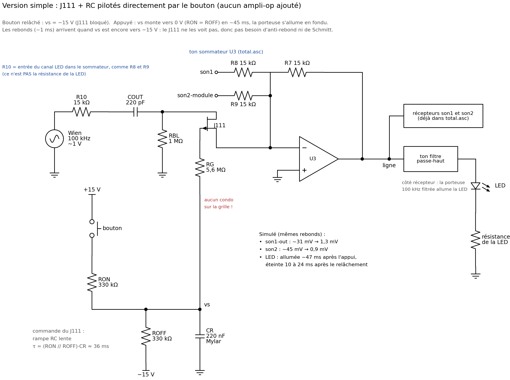
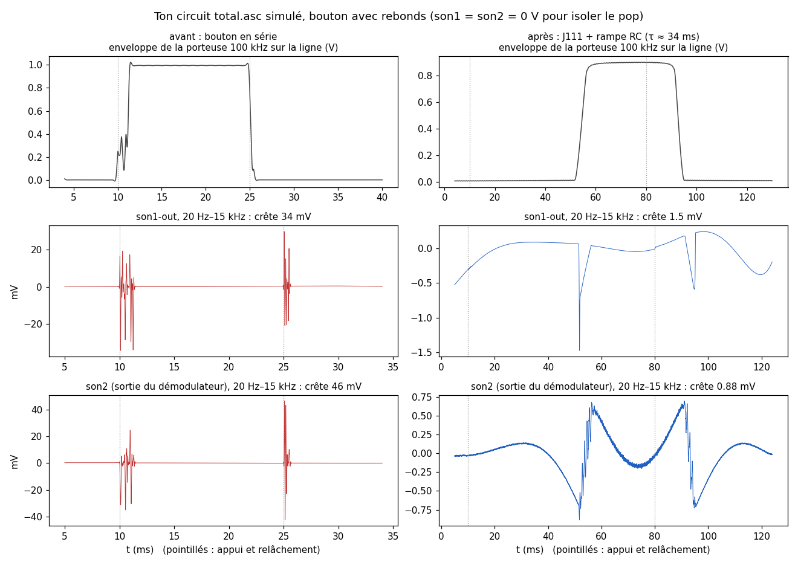
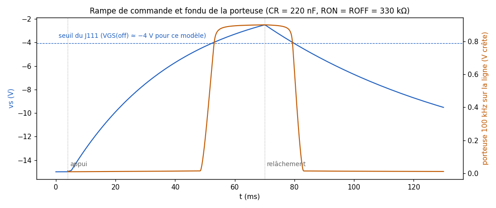

# Rapport technique : bouton de la LED sans pop sur son1 et son2

**Projet ELE2003 — canal LED à 100 kHz sur la ligne de transmission**

---

## 1. Résumé

Quand on appuie sur le bouton qui envoie la porteuse LED (~100 kHz) sur la ligne, on entend un « pop » sur son1 et sur son2.

- **Cause :** le bouton coupe et remet la porteuse d'un coup, et en plus ses contacts rebondissent. Une sinusoïde coupée brusquement étale son spectre jusque dans la bande de son1 (0–10 kHz) et dans celle de son2 (30–58 kHz).
- **Solution :** le bouton ne touche plus la porteuse. Il commande un J111 qui s'ouvre et se ferme **en fondu** grâce à une rampe RC lente. La porteuse monte et descend en quelques millisecondes au lieu d'une microseconde, donc son spectre reste collé à 100 kHz. Aucun ampli-op n'est ajouté.
- **Résultat (simulation de `total.asc`, mêmes rebonds) :**

| | pop sur son1-out (appui / relâchement) | pop sur son2, démodulateur (appui / relâchement) |
|---|---|---|
| Avant (bouton en série avec la porteuse) | 34 mV / 30 mV | 35 mV / 46 mV |
| Après (J111 + rampe RC) | **1,5 mV / 0,6 mV** | **0,9 mV / 0,7 mV** |

La LED s'allume ~47 ms après l'appui et s'éteint 10 à 24 ms après le relâchement. Ces délais sont imperceptibles en pratique.

---

## 2. Le canal LED dans le système

La ligne transporte trois canaux, additionnés par le sommateur inverseur U3 (R7 = 15 kΩ de contre-réaction) :

$$v_{ligne} = -\frac{R_7}{R_8}\,v_{son1} - \frac{R_7}{R_9}\,v_{son2\text{-}module} - \frac{R_7}{R_{34}}\,v_{LED}, \qquad R_7 = R_8 = R_9 = R_{34} = 15\ \text{k}\Omega$$

| Canal | Bande sur la ligne | Récepteur |
|---|---|---|
| son1 | 0–10 kHz (bande de base) | passe-bas Butterworth d'ordre 4, 10 kHz (U2, U1) |
| son2 | porteuse ≈ 48,4 kHz modulée en AM | passe-bande 30–58 kHz (U8–U13) + redresseur + passe-bas (U14–U17) |
| LED | porteuse ≈ 97,7 kHz (Wien U19) | passe-haut d'ordre 4 (U6, U18), puis la LED et sa résistance |

Le pont de Wien de la LED (U19) a $R = 2\ \text{k}\Omega$ et $C = 680\ \text{pF}$. En théorie $f = \frac{1}{2\pi RC} = 117\ \text{kHz}$. En simulation il oscille à **97,7 kHz**, à cause du retard de phase du TL082, avec une amplitude de **0,99 V crête**.

---

## 3. Le problème et sa cause

### 3.1 Diagnostic

On a testé en retirant la LED du récepteur : **le pop est toujours là.** Il ne vient donc pas du courant de la LED dans les masses. Il vient de la **commutation de la porteuse** elle-même.

### 3.2 Pourquoi couper une sinusoïde fait un clic

Allumer la porteuse d'un coup revient à la multiplier par un échelon :

$$x(t) = A\sin(\omega_0 t + \varphi)\,u(t) \quad\xrightarrow{\ \mathcal{L}\ }\quad X(s) = A\,\frac{s\sin\varphi + \omega_0\cos\varphi}{s^2 + \omega_0^2}$$

Aux basses fréquences ($s \ll \omega_0$), cela donne :

$$X(s) \approx \frac{A\cos\varphi}{\omega_0} + \frac{A\sin\varphi}{\omega_0^2}\,s$$

Vu des basses fréquences, chaque front de la porteuse est donc **une impulsion d'aire** $A\cos\varphi/\omega_0$. Le filtre de son1 transforme cette impulsion en clic. Pour un Butterworth d'ordre 4, la crête de la réponse impulsionnelle vaut $0{,}382\,\omega_c$. La crête du clic à la sortie de son1 est donc :

$$v_{clic} \approx 0{,}382\,\omega_c\cdot\frac{A}{\omega_0} = 0{,}382\cdot\frac{10\ \text{kHz}}{97{,}7\ \text{kHz}}\cdot A = 0{,}039\,A$$

Avec $A = 1$ V sur la ligne, ça donne **jusqu'à ~39 mV par front**, selon la phase $\varphi$ au moment du contact. Les simulations donnent 30 à 47 mV, ce qui concorde.

Du côté de son2, le spectre d'un front ($\propto 1/|f - f_0|$) a aussi de l'énergie entre 30 et 58 kHz. Le passe-bande de son2 la laisse passer et le démodulateur la transforme en pop. Les simulations donnent 35 à 68 mV.

### 3.3 Les rebonds multiplient les clics

Un bouton poussoir rebondit pendant ~1 ms ou plus. Dans la simulation, il y a 6 fermetures à l'appui et 4 au relâchement. Chaque fermeture et chaque ouverture refait un front, donc un clic. On entend une petite rafale de clics, c'est le « pop ».

Un anti-rebond (RC + trigger de Schmitt) ne suffit pas. En simulation, il ne reste qu'un seul clic, mais toujours de ~35 mV, parce que la coupure reste brutale. Ce problème est connu en radio sous le nom de *key clicks* (manipulation Morse). La solution classique est d'adoucir l'enveloppe de la porteuse sur quelques millisecondes.

### 3.4 Offset DC

Le TL082 du pont de Wien a un offset typique de ~3 mV, multiplié par le gain du Wien (≈ 3,3). La porteuse a donc ~10 mV de DC. Brancher et débrancher la porteuse fait un saut de DC sur la ligne, et son1 est couplé en DC jusqu'à la sortie. Ça ajoute un petit « toc ».

---

## 4. Solution retenue

### 4.1 Principe

1. **Le bouton ne commute plus le signal.** Il charge ou décharge un condensateur CR à travers des résistances. La tension vs de CR varie lentement, avec $\tau \approx 36$ ms.
2. **Un J111 sert d'interrupteur doux.** vs commande sa grille à travers RG. Le J111 passe de bloqué à conducteur progressivement : la porteuse apparaît et disparaît **en fondu**, en ~3–4 ms. Son spectre reste à ±quelques centaines de Hz autour de 97,7 kHz, loin de son1 et de son2.
3. **COUT bloque le continu et les basses fréquences.** Aucun saut de DC n'arrive sur la ligne.

### 4.2 Schéma

### 4.3 Liste de matériel (pièces ajoutées)

| Repère | Valeur | Rôle |
|---|---|---|
| J1 | **J111** (JFET canal N) | interrupteur doux |
| RON | 330 kΩ | charge CR quand le bouton est appuyé |
| ROFF | 330 kΩ | ramène vs à −15 V quand le bouton est relâché |
| CR | **220 nF Mylar** (film, non polarisé) | fixe la lenteur de la rampe |
| RG | 5,6 MΩ | amène vs à la grille sans « tenir » la grille à 100 kHz |
| COUT | 220 pF | bloque le DC, passe-haut à 48 kHz |
| RBL | 1 MΩ | fixe le DC du drain à 0 V quand le J111 est bloqué |
| R10 = R34 | 15 kΩ (déjà là) | entrée du canal LED dans U3, comme R8 et R9 |
| bouton | poussoir normalement ouvert | entre +15 V et RON |

Le circuit n'ajoute **aucun ampli-op**.

---

## 5. Dimensionnement et calculs

### 5.1 Niveaux de commande

- **Bouton relâché :** RON ne conduit pas et ROFF tire vs vers le −15 V :

$$v_s = -15\ \text{V}$$

- **Bouton appuyé :** vs est un diviseur entre +15 V (par RON) et −15 V (par ROFF) :

$$v_s = \frac{15\,R_{OFF} - 15\,R_{ON}}{R_{ON} + R_{OFF}} = 0\ \text{V} \quad\text{si } R_{ON} = R_{OFF}$$

  Le courant dans le bouton est alors $30\ \text{V}/660\ \text{k}\Omega = 45\ \mu\text{A}$.

**Blocage garanti :** pour le J111, $V_{GS(off)}$ est entre −3 V et −10 V selon la pièce. La source est à la masse virtuelle de U3 (0 V) et le drain ne voit qu'environ ±1 V de porteuse. Avec vs = −15 V, on a donc $V_{GS} \le -14\ \text{V} < V_{GS(off)}$ pour n'importe quel J111.

**Passant :** à $V_{GS} = 0$, $R_{DS(on)} \le 30\ \Omega$ (fiche technique ; 44,5 Ω pour le modèle LTspice). C'est négligeable devant l'impédance de la branche $|R_{10} + Z_{COUT}| = 16{,}7\ \text{k}\Omega$ à 97,7 kHz (0,3 %).

### 5.2 Constantes de temps et délais

$$\tau_{on} = (R_{ON}\,/\!/\,R_{OFF})\,C_R = 165\ \text{k}\Omega \times 220\ \text{nF} = 36{,}3\ \text{ms}$$

$$\tau_{off} = R_{OFF}\,C_R = 330\ \text{k}\Omega \times 220\ \text{nF} = 72{,}6\ \text{ms}$$

Le J111 change d'état quand vs traverse son seuil $V_{th} \approx V_{GS(off)}$. Avec le modèle LTspice, le point à 50 % de la porteuse est à $V_{th} = -4{,}2$ V.

- **Allumage :** $v_s(t) = -15\,e^{-t/\tau_{on}}$ et

$$t_{on} = \tau_{on}\ln\frac{15}{|V_{th}|} = 36{,}3 \times \ln\frac{15}{4{,}2} = 46\ \text{ms}$$

  La simulation donne 47 ms.

- **Extinction :** vs part de sa valeur au moment du relâchement, $v_{s0}$, et descend vers −15 V :

$$t_{off} = \tau_{off}\ln\frac{15 - |v_{s0}|}{15 - |V_{th}|}$$

  Après un appui long ($v_{s0} = 0$), on obtient 24 ms. Après un appui de 70 ms, vs n'est arrivé qu'à −2,5 V et on obtient 10,6 ms, ce que confirme la simulation.

Selon le J111 ($|V_{th}|$ de 3 à 10 V), $t_{on}$ va de **15 à 58 ms**.

### 5.3 Pourquoi on n'a pas besoin d'anti-rebond

Pendant les rebonds, vs part de −15 V et monte très lentement :

| durée des rebonds | vs à la fin des rebonds |
|---|---|
| 1 ms | −14,6 V |
| 5 ms | −13,1 V |
| 10 ms | −11,4 V |

vs reste sous le seuil du J111 (−3 à −10 V). **Le J111 reste donc bloqué pendant toute la durée des rebonds** et ne commence à conduire que bien après. Le RC joue lui-même le rôle d'anti-rebond, donc le trigger de Schmitt n'est pas nécessaire. En simulation, les versions avec et sans Schmitt donnent le même pop.

### 5.4 Le fondu de la porteuse

En simulation, la porteuse sur la ligne passe de 10 % à 90 % en **3,9 ms** à l'allumage. Elle passe de 90 % à 10 % en **3,0 ms** à l'extinction. L'enveloppe ne contient alors que des fréquences de l'ordre de $1/T \approx 300$ Hz autour de 97,7 kHz :

- son2 (30–58 kHz) est à ≥ 40 kHz, soit plus de 100 fois cette largeur ;
- son1 (0–10 kHz) est encore plus loin.

Le pop qui reste (~1 mV) vient surtout du « coude » de la caractéristique du J111 au seuil et de sa légère non-linéarité pendant la transition.

### 5.5 RG = 5,6 MΩ et la linéarisation du J111

Dans la zone ohmique, le courant d'un JFET vaut :

$$I_D = \beta\left[2\,(V_{GS} - V_p)\,V_{DS} - V_{DS}^2\right]$$

Le terme $-\beta V_{DS}^2$ **redresse** la porteuse : il produit une composante continue qui varie pendant le fondu, et cette basse fréquence s'entend comme un pop. Si la grille suit une fraction $k$ de la tension du drain ($V_G = V_{G0} + k\,V_D$), alors :

$$I_D = \beta\left[2\,(V_{GS0} - V_p)\,V_{DS} + (2k - 1)\,V_{DS}^2\right]$$

Avec $k = 1/2$, le terme redresseur disparaît. Pour l'obtenir, il suffit de ne **pas tenir la grille** à 100 kHz :

- les capacités internes du J111 forment un diviseur : $k = \frac{C_{gd}}{C_{gd} + C_{gs}} = \frac{6{,}46}{6{,}46 + 5{,}74} = 0{,}53$, ce qui donne $2k - 1 = 0{,}06$, soit −25 dB de redressement ;
- il faut pour cela que RG soit grande devant l'impédance de ces capacités : $Z = \frac{1}{2\pi f C} = \frac{1}{2\pi \times 97{,}7\ \text{kHz} \times 12{,}2\ \text{pF}} = 134\ \text{k}\Omega$. Avec RG = 5,6 MΩ, le rapport est de 42 ;
- RG ne ralentit pas la rampe : $R_G C_{grille} = 5{,}6\ \text{M}\Omega \times 12{,}2\ \text{pF} = 68\ \mu\text{s} \ll 36\ \text{ms}$ ;
- le courant de fuite de grille ($I_{GSS} \le 1$ nA) ne cause qu'une chute de $\le 5{,}6$ mV dans RG.

**Il ne faut donc jamais mettre de condensateur directement sur la grille.** Il tiendrait la grille à 100 kHz ($k = 0$) et le J111 redresserait la porteuse.

### 5.6 COUT et RBL

COUT forme avec R10 un passe-haut du 1er ordre vers la masse virtuelle de U3 :

$$f_c = \frac{1}{2\pi R_{10} C_{OUT}} = \frac{1}{2\pi \times 15\ \text{k}\Omega \times 220\ \text{pF}} = 48{,}2\ \text{kHz}$$

| fréquence | gain de la branche LED |
|---|---|
| 97,7 kHz (porteuse) | 0,897 (−0,95 dB) |
| 10 kHz | 0,203 (−13,8 dB) |
| 1 kHz | 0,021 (−33,7 dB) |
| DC | 0 (bloqué) |

COUT a aussi deux autres effets :

- **Pas de DC dans la branche.** Le gain de bruit DC de U3 reste $1 + R_7/(R_8/\!/R_9) = 3$, que le J111 soit ouvert ou fermé. L'offset de U3 ne fait donc aucun saut, et l'offset DC du Wien (~10 mV) est bloqué.
- **Le passe-haut atténue le reste du pop dans la bande audio.** En simulation, retirer COUT fait passer le pop de son1 de −90 dB à −58 dB dans la version à étage tampon.

RBL fixe le drain à 0 V en DC quand le J111 est bloqué. Sinon ce nœud flotte et COUT garde une charge qui ferait un saut à la fermeture. RBL vaut 1 MΩ, très grand devant les 16,7 kΩ de la branche, donc il ne prend presque rien au signal.

### 5.7 Niveau de la porteuse sur la ligne

$$v_{ligne,LED} = 0{,}99\ \text{V} \times \frac{R_7}{|R_{10} + Z_{COUT}|} = 0{,}99 \times \frac{15}{16{,}7} = 0{,}89\ \text{V crête}$$

La simulation donne **0,90 V**, contre 0,99 V avant. Il reste deux fuites, négligeables :

- **J111 bloqué :** ~9 mV de porteuse fuient par ses capacités, soit −40 dB. C'est insuffisant pour allumer la LED.
- **Côté récepteurs :** le passe-bas de son1 atténue 97,7 kHz de 79 dB, et le passe-bande de son2 de ~47 dB.

---

## 6. Résultats de simulation

### 6.1 Méthode

- **Modèles :** LTspice 26, ton `TL082.MOD`, le J111 de la bibliothèque standard de LTspice (Linear Systems : $V_{to} = -4{,}05$ V, $\beta = 2{,}91$ mA/V², $C_{gd} = 6{,}46$ pF, $C_{gs} = 5{,}74$ pF), et une LED rouge QTLP690C avec 1 kΩ au bout de ton passe-haut.
- **Bouton :** interrupteur commandé par une source PWL qui reproduit des rebonds réalistes. À l'appui, 6 fermetures en 1,2 ms ; au relâchement, 4 fermetures en 0,42 ms.
- **Mesure du pop :** sortie filtrée 20 Hz–15 kHz (la bande audible), puis valeur crête. son1 et son2 sont mis à 0 V pour isoler le pop.
- **son2 :** le récepteur son2 complet ralentit énormément LTspice (~40 s par ms simulée). Sa sortie est donc calculée à partir de V(ligne) avec la réponse AC mesurée de ton passe-bande et de ton nouveau démodulateur (redresseur = |x|). Ce modèle a été validé contre la simulation complète : 64,4 mV contre 64,3 mV.
- **Banc :** ton `total.asc` du 22 octobre, avec le pont de Wien U19, R34, U3, le récepteur son1 et le modulateur son2 réels.

### 6.2 Avant / après sur ton circuit

| Montage | son1-out appui / relâchement | son2 appui / relâchement |
|---|---|---|
| Bouton en série (avant) | 34 mV / 30 mV | 35 mV / 46 mV |
| J111 + rampe RC (τ ≈ 34–36 ms) | **1,5 mV / 0,6 mV** | **0,9 mV / 0,7 mV** |

Sur ce banc, le « après » a été simulé avec CR = 680 nF et RON = ROFF = 100 kΩ, soit τ = 34 ms. Les valeurs finales, 220 nF et 330 kΩ, donnent τ = 36 ms. La simulation complète de `total.asc` avec ces valeurs n'a pas abouti : LTspice s'est bloqué sur des pas de 2 ns. Les deux combinaisons ont donc été comparées sur le banc simplifié (6.3), et elles donnent les mêmes pops : 1,3 à 1,4 mV sur son1 et 0,9 mV sur son2.

### 6.3 Influence de CR et de RON/ROFF

Banc simplifié, même circuit : porteuse idéale de 1 V à 100 kHz et porteuse son2 idéale.

| CR | RON = ROFF | τ_on | pop son1 | pop son2 | LED allumée après |
|---|---|---|---|---|---|
| 68 pF (erreur de lecture) | 100 kΩ | 3,4 µs | 31 mV | ~45 mV | 0 ms (coupure franche) |
| 220 nF | 100 kΩ | 11 ms | 2,2 mV | 1,0 mV | 15 ms |
| **220 nF** | **330 kΩ** | **36 ms** | **1,3 mV** | **0,9 mV** | **47 ms** |
| 680 nF | 100 kΩ | 34 ms | 1,4 mV | 0,9 mV | 45 ms |

C'est le produit $(R_{ON}/\!/R_{OFF})\,C_R$ qui compte, pas la valeur de CR seule.

### 6.4 Influence de RG

| RG | pop son1 | pop son2 |
|---|---|---|
| 10 MΩ | 1,4 mV | 0,9 mV |
| **5,6 MΩ** | **1,4 mV** | **0,9 mV** |
| 2,2 MΩ | 1,1 mV | 1,1 mV |
| 1 MΩ | 0,5 mV | 1,9 mV |
| 100 kΩ | 8,9 mV | 6,3 mV |

Au-dessus de ~1 MΩ, tout fonctionne. À 100 kΩ, la grille est trop « tenue » et le J111 redresse la porteuse.

### 6.5 Alternatives étudiées

Même banc simplifié qu'en 6.3, avec CR = 680 nF.

| Solution | pièces ajoutées | pop son1 | pop son2 | remarque |
|---|---|---|---|---|
| bouton en série (avant) | — | 47 mV | 59–68 mV | rafale de clics |
| un condensateur de 220 pF en série | 1 | 29–32 mV | 46–52 mV | insuffisant, les rebonds restent |
| RC + Schmitt + J111 qui commute d'un coup | ~12, 1 ampli-op | ~35 mV | ~45 mV | un seul clic, mais toujours fort |
| **J111 + rampe RC (retenue)** | **7, aucun ampli-op** | **1,4 mV** | **0,9 mV** | simple et efficace |
| J111 + rampe + atténuateur + étage UB | 12, 1 ampli-op | 0,04 mV | 0,04 mV | silence complet, plus complexe |

Un filtre seul ne peut pas régler son2 : sa bande (30–58 kHz) est trop proche de 100 kHz pour qu'un filtre simple les sépare. Il faut **éviter de créer** le spectre parasite (fondu), pas le filtrer après.

---

## 7. Mise en œuvre et vérification

### 7.1 Câblage

Deux placements équivalents ont été simulés, avec le même résultat :

- **A, comme sur le schéma :** Wien → R10 15 kΩ → COUT → drain du J111. La source va directement sur l'entrée (−) de U3, et RBL relie le drain à la masse.
- **B, à la place de l'ancien bouton, entre `del` et `led` :** Wien (`del`) → COUT → drain du J111, avec RBL vers la masse. La source va sur `led`, puis R34 vers l'entrée (−) de U3. C'est le montage du fichier `total-bouton-doux.asc`.

La commande est la même dans les deux cas :

- le bouton est entre **+15 V** et RON ;
- RON arrive sur le nœud vs ;
- ROFF relie vs au **−15 V** ;
- CR relie vs à la masse ;
- RG relie vs à la grille.

### 7.2 Vérifications sur la breadboard

1. **Multimètre sur vs :** environ −15 V bouton relâché. À l'appui, la tension doit **monter doucement** vers 0 V (quelques dixièmes de seconde) et non sauter. Au relâchement, elle redescend doucement.
2. **Oscilloscope sur la ligne :** à l'appui, l'enveloppe de la porteuse doit monter en quelques millisecondes et non d'un coup.
3. **La LED** s'allume environ 1/20 de seconde après l'appui.
4. **À l'écoute :** plus de pop, ou un pop très faible.

### 7.3 Pièges rencontrés

- **Marquage des condensateurs :** « 680 » veut dire **68 pF**, tandis qu'un 680 nF est marqué « 684 » ($68 \times 10^4$ pF). Avec 68 pF, τ vaut 3,4 µs au lieu de 34 ms. La commutation redevient brutale et le pop revient (31 mV en simulation).
- **Condensateur électrolytique :** il est polarisé. Ici vs est toujours négatif, donc il faut le **+ à la masse** et le **− sur vs**. À l'envers, il fuit, vs ne descend plus à −15 V et le J111 ne se bloque plus complètement. Un condensateur film (Mylar) ou céramique évite le problème.
- **Aucun condensateur sur la grille**, voir 5.5.
- **Dans `total.asc`, la sortie du Wien s'appelle `del`** alors que R34 est branchée sur `led`. Sans bouton simulé entre les deux, la porteuse LED n'arrive pas sur la ligne en simulation.

---

## 8. Limites et points ouverts

- **Offset :** le modèle TL082 n'a pas d'offset. Les sauts de DC réels sont bloqués par COUT, mais ils n'ont pas pu être chiffrés en simulation.
- **J111 :** sa tension $V_{GS(off)}$ varie beaucoup d'une pièce à l'autre (−3 à −10 V). Le blocage est garanti par vs = −15 V. Seul le délai d'allumage change, de 15 à 58 ms.
- **Rebonds :** ils varient selon le bouton. Le montage tolère au moins 10 ms de rebonds (vs = −11,4 V à 10 ms).
- **LED du récepteur :** en simulation de `total.asc`, ton passe-haut ne sort que **0,83 V crête** sur `led-out`. C'est trop peu pour une LED rouge (~1,7 V) : il passe 0,02 mA. Si ta vraie LED s'allume, c'est que le gain réel de ton récepteur est plus grand qu'en simulation. Sinon, il faudra augmenter le gain de U6/U18 ou la porteuse.

---

## 9. Fichiers

| Fichier | Contenu |
|---|---|
| `schema-led-simple.png` | schéma de la solution retenue (valeurs finales) |
| `total-bouton-doux.asc` | copie de `total.asc` avec la solution entre `del` et `led`, et le bouton simulé. La simulation complète prend environ 1 h à cause du récepteur son2. Mettre V4 et V5 à 0 V pour voir le pop. |
| `rapport-fig-pop.png`, `rapport-fig-rampe.png` | figures de ce rapport |
| `led-bouton-antipop.asc`, `schema-led-antipop.png` | première version (anti-rebond + Schmitt + étage UB), plus complexe |
| `schema-masse-led.png` | bonne pratique de câblage des masses (masse en étoile). Ce n'était pas la cause du pop ici. |

---

## 10. Références

- Siliconix, *AN105 — FETs As Voltage-Controlled Resistors* (figure 6 : linéarisation par rétroaction de Vd/2 sur la grille) : <https://www.vishay.com/docs/70598/70598.pdf>
- R. Elliott (ESP), *Muting Circuits For Audio* (mute à JFET avec fondu RC sans clic) : <https://sound-au.com/articles/muting.html>
- J. Ganssle, *A Guide to Debouncing, Part 2* : <https://www.ganssle.com/debouncing-pt2.htm>
- W9CF, *Spectral analysis of CW keying* (key clicks, temps de montée et bande occupée) : <https://na6o.com/amateur_radio/ewExternalFiles/W9CF_Spectral_analysis_of_CW_keying.pdf>
- Wikipedia, *Continuous wave* (section key clicks) : <https://en.wikipedia.org/wiki/Continuous_wave>
- R. Quan, *A guide to using FETs for voltage controlled circuits, Part 2*, EDN Asia : <https://www.ednasia.com/?p=3977>
- Fiche technique J111 (onsemi) : $V_{GS(off)}$ −3 à −10 V, $R_{DS(on)} \le 30\ \Omega$, $I_{GSS} \le 1$ nA.
